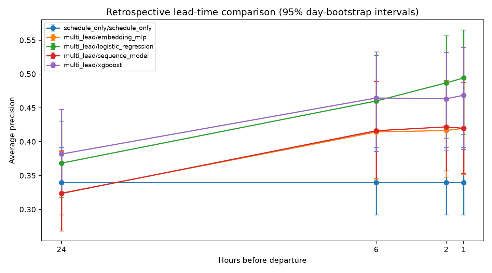

# Flight Arrival Delay Prediction

How early can we identify flights likely to arrive at least 15 minutes late? This project estimates arrival-delay risk for flights departing from Newark (EWR), John F. Kennedy (JFK), and LaGuardia (LGA) at **24 h, 6 h, 2 h, and 1 h before scheduled departure**. It compares a schedule-only baseline, two classical models, and two neural models on the same flights.

**Main finding.** In the retrospective November–December 2013 evaluation, Logistic Regression had the highest one-hour calibrated PR-AUC at **0.4941**. XGBoost led at 24 and 6 hours and outperformed both neural models at every lead time.

## Data and prediction design

The 2013 dataset combines flight schedules and recorded outcomes with airline, airport, and hourly origin-weather data. Of **336,776 scheduled flights**, **327,346** have a known arrival delay. **80,100** of those flights (24.47%) arrived at least 15 minutes late. The 9,430 flights with unknown arrival delay are excluded from supervised modeling. Each eligible flight contributes one feature row per lead time, for **1,309,384 rows**. [Data quality and coverage](reports/step4_multi_lead_quality.md)

Feature availability is measured at scheduled departure minus the prediction lead time.

- **Schedule and calendar.** Carrier, route, scheduled time, distance, airport attributes, and holiday proximity.
- **Delay history.** Rolling 7- and 28-day delay rates by carrier, route, and origin. A prior flight contributes only after its reconstructed arrival time plus a 15-minute availability buffer.
- **Weather.** The most recent origin observation within three hours of the cutoff, weather trends over three and six hours, and up to 12 past readings for the sequence model.

The target flight’s actual outcomes are held out of the model inputs. Automated checks perturb future records and verify that earlier features stay the same. [Feature definitions and timing assumptions](docs/Engineering/step-3-asof-feature-handoff.md)

## Models and evaluation

| Model | Inputs and approach |
|---|---|
| Schedule-only baseline | Logistic Regression on schedule, calendar, and static reference features |
| Logistic Regression | Full tabular features with a periodic spline for departure hour |
| XGBoost | Boosted decision trees on the full tabular features |
| Embedding MLP | A feed-forward neural network with learned categorical embeddings |
| Sequence GRU | Tabular inputs plus a recurrent encoder for recent origin-weather observations |

Six expanding-window folds validate on **May through October 2013**, with earlier months used for training. The four lead-time rows for each flight stay in the same fold. Preprocessing and model fitting use only the training window, and only outcomes available by the fold’s first prediction cutoff enter training. The GRU uses weather sequences that pass timestamp, ordering, and padding checks. Per-lead isotonic calibration uses eligible October out-of-fold predictions. November–December provides a retrospective evaluation because that period was examined in the earlier analysis. [Experimental protocol](configs/project_contract_v2.yaml)

The primary metric is **average precision (PR-AUC)**. The evaluation also reports ROC-AUC, Brier score, calibration error, and precision and recall when flagging the highest-risk 10% of flights. Confidence intervals use a bootstrap that resamples whole service days. [Evaluation methods](docs/Engineering/step-8-9-evaluation-handoff.md)

## Results



The one-hour evaluation covers **53,991 flights**, including **13,946 delayed arrivals**. The 10% alert budget flags exactly **5,399 flights** per model.

| Model | Raw PR-AUC | Calibrated PR-AUC | Precision at 10% | Recall at 10% |
|---|---:|---:|---:|---:|
| Logistic Regression | **0.5061** | **0.4941** | **63.57%** | **24.61%** |
| XGBoost | 0.4915 | 0.4686 | 61.59% | 23.84% |
| Embedding MLP | 0.4314 | 0.4197 | 53.62% | 20.76% |
| Sequence GRU | 0.4358 | 0.4197 | 52.27% | 20.24% |
| Schedule-only baseline | 0.3459 | 0.3394 | 38.03% | 14.72% |

At one hour, Logistic Regression flagged **3,432 delayed flights** and raised **1,967 false alerts**. Its calibrated PR-AUC had a 95% day-bootstrap interval of **[0.4103, 0.5651]**. At 24 hours, both neural models trailed the schedule-only baseline. [Results by lead time](reports/supplied_run/RESULTS.md), [All 20 model and lead-time results](reports/supplied_run/numerical_results.csv)

## Limitations

- The reported evaluation used **one configuration per model**. The full 40-configuration search and the matched comparison with the earlier feature set remain outstanding. The present results establish performance for the evaluated configurations and population.
- The evidence covers one year and three departure airports. Generalization to other airports or an unseen year remains open. Historical weather observations serve as a proxy for forecasts. The GRU uses weather sequences, with same-day departure inputs disabled.
- The compared predictions share flight IDs, labels, and folds. Exact numerical feature parity across the archived neural and classical runs remains unverified because the original neural feature tables are unavailable. [Evaluation provenance and diagnostics](reports/supplied_run/evaluation.json)

## Offline rescheduling analysis

A planned extension would compare predicted delay risk for the original schedule and hypothetical departure shifts of ±15, ±30, or ±60 minutes. Each scenario would use the same prediction lead time and model, with the cutoff and time-dependent features recalculated for the shifted departure. The change in predicted risk would measure sensitivity to the schedule assumptions. Assessing operational feasibility would require data on crews, aircraft rotations, gates, and passenger connections. [Rescheduling design](docs/Engineering/implementation-phase-6-plan.md)

## Team responsibilities

| Contributor | Responsibility | Project output |
|---|---|---|
| Deepak (`interterrestrial`) | Experimental protocol, data preparation, label definition, and schedule validation | Project contract and validated data inputs |
| Utkarsh | Time-aware feature engineering, leakage checks, and multi-lead dataset generation | Feature tables, sequence inputs, and data-quality checks |
| Meet | Classical benchmarks and presentation of findings | Schedule-only, Logistic Regression, and XGBoost baselines, plus the report and slides |
| Aarush | Neural modeling and sequence feasibility | Embedding MLP, weather-sequence GRU, and model predictions |
| Kevish | Calibration, alert-budget evaluation, and model comparison | Evaluation tables, confidence intervals, and diagnostic figures |

## Technology stack

| Area | Tools |
|---|---|
| Data preparation and features | Python 3.13, pandas, NumPy |
| Classical and neural models | scikit-learn, XGBoost, PyTorch |
| Analysis and figures | Matplotlib, JupyterLab |
| Testing and reproducibility | pytest, versioned experiment configurations and data manifests |

## Repository layout

```text
data/raw/                Source CSVs
data/processed/          Labeled flights and generated feature tables
configs/                 Experiment contracts, source manifest, and model settings
src/data/                Ingestion, schedule parsing, and labels
src/features/            Cutoff-aware features and multi-lead data exports
src/models/classical/     Schedule-only, Logistic Regression, and XGBoost models
src/models/neural/        Embedding MLP and sequence GRU
src/evaluation/          Calibration, scoring, metrics, and diagnostics
tests/                   Data, leakage, model, and integration checks
reports/supplied_run/    Published results, tables, and figures
notebooks/               Exploratory analysis from the earlier benchmark
docs/                    Design, research notes, and technical documentation
artifacts/               Generated checkpoints and predictions, ignored by Git
```

## Run locally

Install the dependencies and run the project checks from the repository root.

```bash
python3.13 -m venv .venv
source .venv/bin/activate
python -m pip install -r requirements.txt
python -m src.checks
```

Run `python -m src.run_v2` to regenerate the experiment from the bundled data using the full search budget. Generated models and predictions go under `artifacts/v2/`, and evaluation outputs go under `reports/v2/`. [Archived-run reproduction](PROJECT_STATUS.md#run-and-inspect-progress), [Verification record](reports/step9_verification.md)
