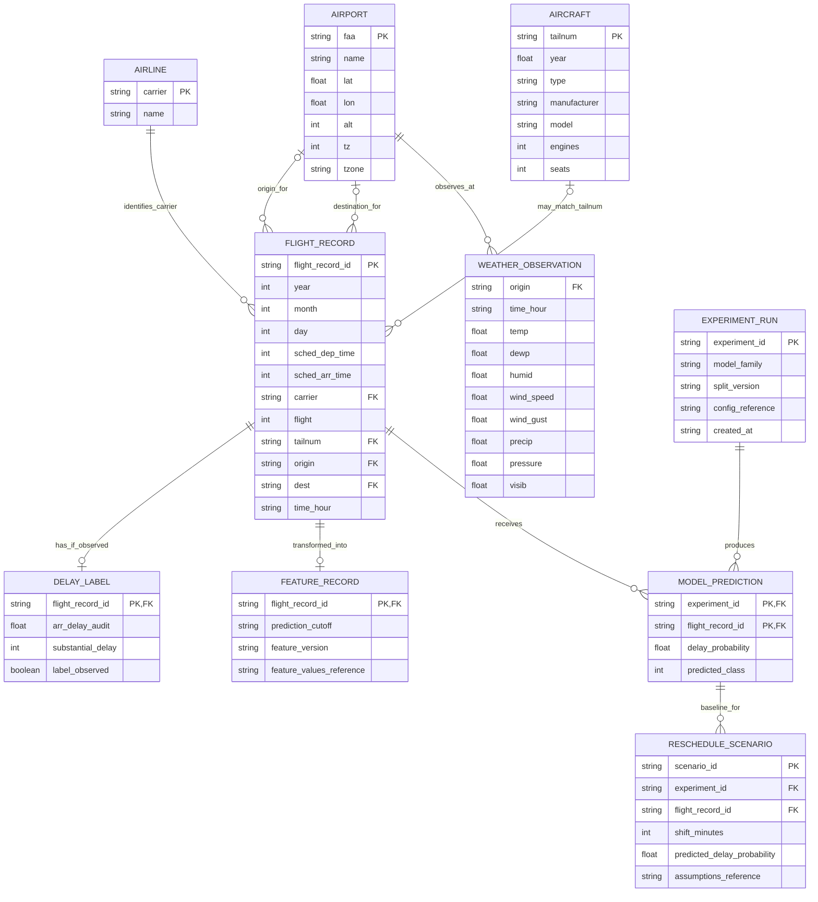

# Flight Delay Prediction — Entity Relationship Diagram

## 1. Overview

This is a **conceptual analytical data model** for the project, not a claim that the CSV files are stored in a relational database. It shows the source entities and the derived records needed to train and evaluate models. The actual data remains in CSV and generated analytical artifacts unless the team later chooses a database.

A generated `flight_record_id` should be assigned during ingestion to keep a stable row identity across data preparation, feature generation, predictions, and reports. A naive combination of date, carrier, and flight number is not guaranteed to uniquely identify every row in this file set.

## 2. ER Diagram

## 3. Source Entities

| Entity | Source | Description |
|---|---|---|
| `FLIGHT_RECORD` | `nyc_flights.csv` | One source row for a scheduled flight, with a generated stable identifier during ingestion |
| `AIRLINE` | `nyc_airlines.csv` | Carrier code and airline name |
| `AIRPORT` | `nyc_airports.csv` | Airport reference information keyed by `faa` |
| `AIRCRAFT` | `nyc_planes.csv` | Aircraft reference data keyed by `tailnum` |
| `WEATHER_OBSERVATION` | `nyc_weather.csv` | Weather values for an origin airport and observation timestamp |

## 4. Derived Entities

### Delay Label

The label record is derived from `arr_delay`. `substantial_delay` is 1 when arrival delay is at least 15 minutes and 0 when it is below 15 minutes. When `arr_delay` is missing, the target is unobserved; such rows are excluded from supervised classification and counted in the quality report. The audit delay field must not be passed to model training.

### Feature Record

Represents a model-ready feature row created with an explicit prediction cutoff and feature-definition version. This entity separates feature engineering from target construction and provides a place to trace which cutoff and transformations were applied.

### Experiment Run and Model Prediction

An experiment run records model family, data split, and configuration references. Model predictions are stored in a common format keyed by experiment and `flight_record_id`, allowing fair comparisons over identical rows.

### Reschedule Scenario

A scenario records a candidate time shift, its predicted probability, and the assumptions used. It does not represent a real scheduled change or prove a causal reduction in arrival delay.

## 5. Relationship and Join Constraints

- A carrier may appear on many flight records. The supplied airline lookup covers every carrier code in the current flights file.
- An airport may be an origin or destination for many flights. The supplied airport lookup covers all three origins but lacks `BQN`, `PSE`, `SJU`, and `STT` as destinations; unmatched destination attributes must be preserved and reported.
- Aircraft lookup is optional and incomplete: not every non-missing flight tail number matches the supplied plane table. A missing aircraft match must not drop the flight record.
- Weather is associated with an origin airport and a timestamp. Feature creation must use an as-of join at or before T−60 rather than assuming a same-hour row was available by the cutoff.
- Some flights have no observed arrival delay, so a flight can exist without a valid delay label.
- Prediction outputs must be keyed by the stable generated identifier, not by flight number alone.

## 6. Important Constraints

1. Preserve raw CSVs unchanged.
2. Treat identifiers and join keys as strings where leading zeros or non-numeric codes may matter.
3. Report unmatched keys and missing values rather than silently discarding records.
4. Keep the target separate from features.
5. Record experiment and feature versions so comparisons can be reproduced.
