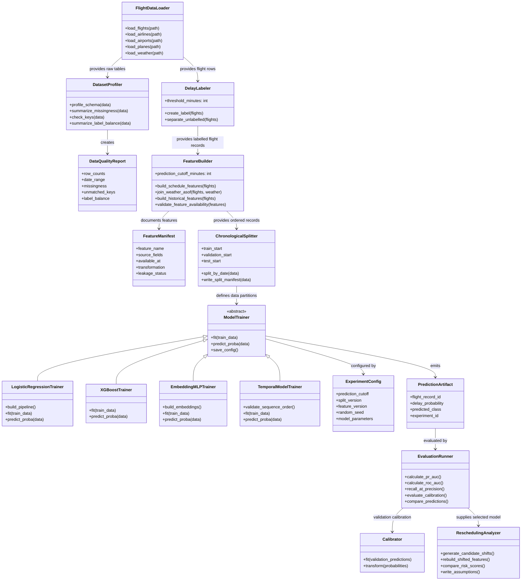

# Flight Delay Prediction — UML Class Diagram

## 1. Overview

The class diagram describes the logical responsibilities of the analytical pipeline. It is a conceptual design, not a claim that these exact Python classes have already been implemented. The eventual module and class names can differ, provided that data contracts, ownership boundaries, and prediction-time rules remain consistent.

## 2. Class Diagram

## 3. Class Responsibilities

### Data Preparation — Contributor 1

- **`FlightDataLoader`** reads the five CSV sources and preserves raw inputs.
- **`DatasetProfiler`** computes schemas, date coverage, missingness, duplicate checks, key coverage, and label counts.
- **`DelayLabeler`** creates the binary target from `arr_delay` and separates records without a target.
- **`DataQualityReport`** stores measured counts and observed data issues for handoff.

### Feature Engineering — Contributor 2

- **`FeatureBuilder`** produces schedule, calendar, route, as-of weather, and lagged historical features.
- **`FeatureManifest`** records each feature's source, transformation, prediction-time availability, and leakage status.

### Classical Models — Contributor 3

- **`LogisticRegressionTrainer`** owns the baseline preprocessing and classifier pipeline.
- **`XGBoostTrainer`** owns the boosted-tree model and its configuration.

### Deep Learning — Contributor 4

- **`EmbeddingMLPTrainer`** owns the categorical-embedding MLP.
- **`TemporalModelTrainer`** is optional. It should be implemented only if a valid time-ordered sequence is available.

### Evaluation and Rescheduling — Contributor 5

- **`ChronologicalSplitter`** creates and documents the agreed date boundaries.
- **`EvaluationRunner`** calculates common metrics and compares predictions on the same held-out rows.
- **`Calibrator`** fits any calibration transformation using permitted data, without final test labels.
- **`ReschedulingAnalyzer`** creates candidate schedule shifts, rebuilds affected features, compares risk scores, and records assumptions.

## 4. Important Design Rules

- `DelayLabeler` must not provide `arr_delay` as a feature field to a trainer.
- `FeatureBuilder` must reject post-departure fields and validate the T−60 cutoff.
- Historical features must be based only on completed prior dates.
- The temporal trainer is optional; its inputs must be strictly ordered and available at prediction time.
- All trainers must emit probabilities aligned to the same stable flight identifiers for evaluation.
- Rescheduling operates on candidate feature rows and model probabilities; it does not claim to model the full airline operating network.
