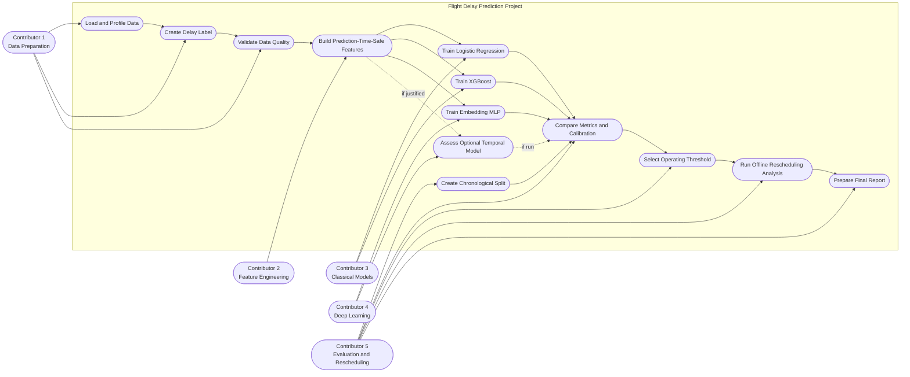

# Flight Delay Prediction — Use Case Diagram

## 1. Overview

This diagram describes the project's analytical workflow and the responsibilities of its five contributors. The project does not currently define a production user-facing application, so the actors are project roles interacting with data, feature, model, evaluation, and reporting tasks.

## 2. Use Case Diagram

## 3. Actor Responsibilities

### Contributor 1 — Data Preparation

Loads and profiles the five source CSVs, validates required columns and row structure, creates the `substantial_delay` label from `arr_delay`, reports unknown labels and exclusions, and documents data-quality findings. This contributor stops before feature engineering and model training.

### Contributor 2 — Feature Engineering

Builds schedule, calendar, route, safe weather, and historical delay features. Owns the feature definitions and enforces the T−60 availability cutoff, prior-date-only historical aggregates, and leakage tests.

### Contributor 3 — Classical Models

Implements Logistic Regression and XGBoost using the agreed feature matrix and split contract. Supplies reproducible configs and predictions keyed by the common flight-record identifier.

### Contributor 4 — Deep Learning

Implements the compact MLP with embeddings for airline, origin, and destination. Determines whether a temporal model can be built with valid event ordering and without future information; a temporal experiment is optional.

### Contributor 5 — Evaluation and Rescheduling

Defines and freezes chronological data partitions, implements common metrics and calibration analysis, selects the operating threshold using validation data, compares models on shared rows, performs the offline rescheduling analysis, and integrates results into the final report.

## 4. Project Rules

- The target is based on arrival delay of at least 15 minutes.
- Missing arrival delay is an unknown label, not class zero.
- Post-departure fields are prohibited from the pre-departure model features.
- Feature engineering, date split, and model evaluation must agree on the same T−60 cutoff.
- The final test partition must not be used for hyperparameter tuning, calibration fitting, or threshold selection.
- Rescheduling output is an offline, non-causal risk comparison.
