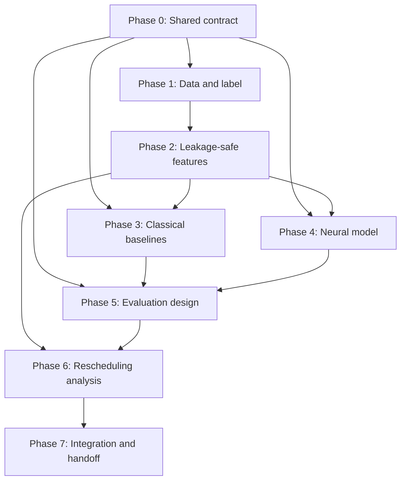

# Implementation Phases — Flight Delay Prediction

**Project:** Flight Delay Prediction via Gradient Boosting and Temporal Deep Learning  
**Purpose:** Deliver a reproducible, leakage-safe modeling pipeline and a clearly bounded offline rescheduling analysis.

This plan is the project-wide roadmap. Each phase has a dedicated implementation plan in this folder. Work should move through the phases in order where dependencies require it; phases may overlap only when the shared data and artifact contracts are already agreed.

## Phase overview

| Phase | Name | Lead contributor | Main output | Depends on |
|---|---|---|---|---|
| 0 | Repository and experiment contract | Contributor 1 coordinates; all review | Agreed environment, data/model contracts, split and decision rules | None |
| 1 | Load, profile, clean and label data | Contributor 1 | Validated labelled dataset and data-quality report | Phase 0 |
| 2 | Leakage-safe feature engineering | Contributor 2 | Versioned feature matrix and feature manifest | Phase 1 |
| 3 | Classical baselines | Contributor 3 | Logistic Regression and XGBoost pipelines and predictions | Phases 0–2 |
| 4 | Neural model and temporal feasibility | Contributor 4 | Embedding MLP and optional temporal-model go/no-go report | Phases 0–2 |
| 5 | Evaluation, calibration and comparison | Contributor 5 | Fair model comparison, thresholds and error analysis | Phases 3–4 |
| 6 | Offline rescheduling what-if analysis | Contributor 5; Contributors 2–4 support | Candidate-shift predictions and non-causal analysis report | Phases 2 and 5 |
| 7 | Integration, reproducibility and final handoff | Contributor 5 coordinates; all review | End-to-end run, final report and maintainable repository | Phases 0–6 |

## Dependency flow

## Project-wide rules

1. **Keep the raw data immutable.** The five supplied CSVs are inputs, not working files. Store generated data separately.
2. **Preserve the prediction-time contract.** The initial prediction point is 60 minutes before scheduled departure (**T−60**). Every feature must be defensibly available by that point.
3. **Define the target correctly.** `substantial_delay = 1` if `arr_delay >= 15`; `0` if `arr_delay < 15`; missing `arr_delay` means unknown label and is excluded from supervised training/evaluation. It is never automatically a negative.
4. **Prevent leakage by construction.** Exclude post-departure fields such as `dep_time`, `dep_delay`, `arr_time`, `arr_delay`, and `air_time` from model inputs. Aircraft tail number or aircraft attributes remain excluded unless availability at T−60 is justified and documented.
5. **Use chronological evaluation.** The proposed partition is training through 31 August 2013, validation 1 September–31 October 2013, and testing 1 November–31 December 2013. Inspect date-level counts and target prevalence before freezing the split; any change must be written down before model comparison. Do not use random splitting as the primary result.
6. **Treat observed weather honestly.** Join the latest origin-airport weather observation no later than T−60. Reject observations older than three hours before the cutoff. The dataset contains observations, not forecast vintages; this is a limitation of the prospective scenario.
7. **Build historical features with strict chronology.** Historical delay aggregates must use completed dates strictly before the target flight's date. Never compute aggregates from the entire dataset and then split.
8. **Use common contracts.** All models must share the same eligible labelled population, split definition and prediction-output schema. Model-specific preprocessing may differ but must be fitted using training data only.
9. **Do not invent results.** Metrics, thresholds, model selection, temporal-model viability and rescheduling findings are outputs to measure, not assumptions to fill in.
10. **Keep the rescheduling analysis non-causal.** It is a model-based what-if exercise, not proof that moving a flight will reduce actual delay or a validated airline schedule optimizer.

## Cross-phase artifact contracts

Agree these in Phase 0 and update them only through a reviewed change:

- **Stable row identifier:** `flight_row_id`, unique for every source flight row and stable across all generated artifacts.
- **Labelled data:** one row per retained source flight, stable identifier, parsed schedule date/time fields, label, and documented label availability/exclusion status.
- **Feature matrix:** one row per eligible labelled flight; `flight_row_id` and target are kept outside the feature columns passed to estimators; an accompanying manifest names each feature and its source, cutoff rule, missing-value policy and type.
- **Split manifest:** source row ID, date, and split assignment, or a deterministic rule plus a generated manifest that can be audited.
- **Prediction file:** at minimum `flight_row_id`, `y_true`, `y_probability`, `split`, `model_name`, and `run_id`. All probabilities must be finite and in `[0, 1]`.
- **Run metadata:** configuration, random seed where applicable, code version/commit, dependency versions, feature-manifest version and data-file fingerprints.

## Contributor ownership

| Contributor | Core ownership | Does not own alone |
|---|---|---|
| 1 — Data | Five-file loading, data quality, target and exclusions | Feature selection or model evaluation |
| 2 — Features | Schedule, reference joins, weather and historical features; leakage tests | Changing label/split contracts independently |
| 3 — Classical ML | Logistic Regression and XGBoost | Official common comparison or test-threshold tuning |
| 4 — Deep learning | Embedding MLP; optional temporal feasibility experiment | Changing eligible rows or split for a better score |
| 5 — Evaluation and integration | Split contract, evaluation, calibration, rescheduling and final integration | Reimplementing other contributors' components without review |

## Phase gates

Each phase ends with a review against the acceptance criteria in its dedicated plan. The next phase should not rely on a feature, metric or artifact that has not been checked. If a phase cannot be completed safely, record the blocker, evidence and a no-go/defer decision instead of silently weakening data rules.

## Detailed plans

- [Phase 0 — Repository and experiment contract](implementation-phase-0-plan.md)
- [Phase 1 — Load, profile, clean and label data](implementation-phase-1-plan.md)
- [Phase 2 — Leakage-safe feature engineering](implementation-phase-2-plan.md)
- [Phase 3 — Classical baselines](implementation-phase-3-plan.md)
- [Phase 4 — Neural model and temporal feasibility](implementation-phase-4-plan.md)
- [Phase 5 — Evaluation, calibration and comparison](implementation-phase-5-plan.md)
- [Phase 6 — Offline rescheduling analysis](implementation-phase-6-plan.md)
- [Phase 7 — Integration, reproducibility and handoff](implementation-phase-7-plan.md)
