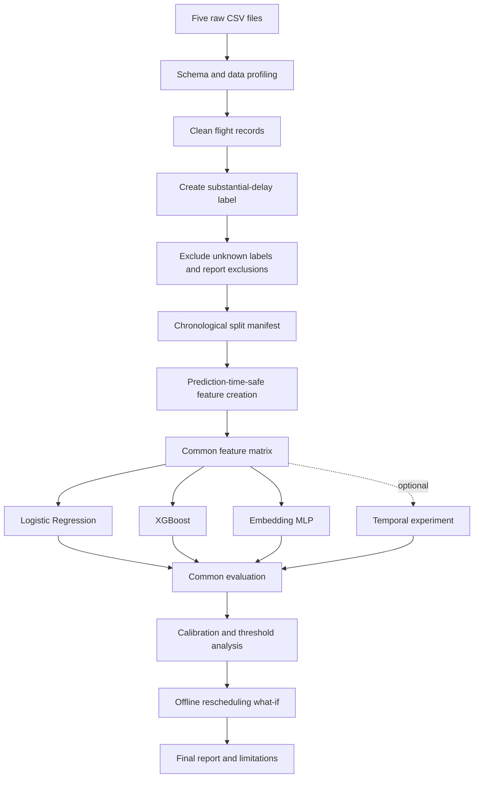

# Flight Delay Prediction — Project Design and Modeling Specification

**Document:** `Design.md`  
**Version:** 1.0  
**Status:** Initial analytical design  
**Project category:** Offline machine learning  
**Prediction cutoff:** T−60 minutes before scheduled departure

---

## 1. Purpose

This document defines the end-to-end data and modeling design for the Flight Delay Prediction and Rescheduling project. The deliverable is a reproducible analytical pipeline, not a user-interface product. The design therefore describes data flow, feature availability, model contracts, evaluation, and interpretation rather than visual styling or application screens.

## 2. Design Principles

1. **Prediction time comes first.** Every input must be available at the selected decision time.
2. **Outcomes stay separate from features.** Actual arrival delay creates the target and is never a model input.
3. **Chronology is enforced.** Historical statistics, data partitions, and optional temporal sequences must respect event order.
4. **Comparisons are fair.** Required models use the same examples, target definition, date split, and metric definitions.
5. **Raw data is immutable.** Cleaning produces new outputs and reports rather than modifying source CSV files.
6. **Assumptions are visible.** Incomplete reference joins, missing observations, and rescheduling limitations are documented.
7. **Complexity must earn its place.** Logistic Regression establishes a baseline before the team interprets more complex models.

## 3. High-Level Pipeline

The exact implementation modules may differ, but the data contract and evaluation sequence should remain consistent.

## 4. Prediction-Time Design

### 4.1 Selected cutoff

The initial design uses **T−60**, meaning 60 minutes before the scheduled departure. The cutoff provides a common basis for deciding which schedule, weather, and historical inputs are valid. If another cutoff is later selected, all feature logic and model comparisons must change together.

### 4.2 Feature availability classes

| Field or feature type | Initial treatment | Rationale |
|---|---|---|
| Calendar fields derived from scheduled date | Candidate | Known from schedule |
| Scheduled departure/arrival times | Candidate | Known from schedule |
| Carrier, origin, destination, route | Candidate | Normally known before departure |
| Historical airport/carrier/route delay aggregates | Candidate with strict lagging | Must use completed prior dates only |
| Weather observations | Candidate with as-of restriction | Use the latest observation no later than T−60 and no more than three hours old |
| `tailnum` and aircraft attributes | Conditional | Exclude unless aircraft assignment is known by T−60 and the link is reliable |
| `dep_time`, `dep_delay` | Prohibited | Actual departure information is unavailable before departure |
| `arr_time`, `arr_delay`, `air_time` | Prohibited | Post-departure or arrival outcomes |
| Any feature computed from same-day realized delays | Prohibited for this design | Would expose outcomes not known at T−60 |

`year`, `month`, and `day` in the source may be used to construct the scheduled date. Do not assume that a column is safe simply because it is present in the source CSV.

### 4.3 Weather as-of behavior

Weather records are historical observations, not archived forecasts. For a flight's origin and cutoff timestamp, the feature builder should select the latest eligible record with `weather.time_hour <= cutoff`. If the observation is older than three hours, set the weather inputs to missing and record the coverage. Do not join the observation at the scheduled-departure hour if that observation timestamp is after T−60.

### 4.4 Historical features

Initial historical features may summarize previous delays by origin, destination, carrier, route, or hour-of-day group. Each aggregate must be computed from flights whose service dates are strictly earlier than the target flight date. The first available dates may have limited history; this should be represented as missing or a documented fallback rather than using future rows.

## 5. Data Processing Design

### 5.1 Source files

- `nyc_flights.csv`: primary fact table for flight schedules and outcomes.
- `nyc_airlines.csv`: carrier lookup.
- `nyc_airports.csv`: airport reference attributes.
- `nyc_planes.csv`: aircraft reference table; join coverage is incomplete.
- `nyc_weather.csv`: hourly origin-airport weather observations.

### 5.2 Target construction

For rows where `arr_delay` is present, set `substantial_delay = 1` if `arr_delay >= 15`, otherwise set it to `0`. Rows without `arr_delay` have unknown targets and are excluded from the classification dataset. Do not replace a missing target with zero and do not claim that each missing row is confirmed cancelled.

### 5.3 Joining reference data

- Carrier lookup is keyed by `carrier`.
- Origin and destination airport lookups are keyed by airport code (`faa`), but four destination codes present in the flight data have no row in the supplied airport lookup. Preserve those flight records and report unmatched keys.
- Aircraft lookup is keyed by `tailnum`, but only a portion of non-missing flight tail numbers match the supplied plane table. Never discard flights solely because this optional reference lookup fails.
- Weather should be joined by origin and timestamp using the as-of rule in §4.3, not by blindly attaching the same-hour record.

## 6. Model Design

### 6.1 Logistic Regression baseline

Use a preprocessing pipeline that handles numeric and categorical fields without leaking target information. Categorical encoding and numeric imputation/scaling, where used, must be fitted on the training partition only. Class weighting may be considered, but report the chosen configuration.

### 6.2 XGBoost

Use XGBoost for nonlinear interactions across schedule, route, weather, and historical features. Record the categorical handling strategy, hyperparameters, early-stopping data, and training seed. Any tuning must use train/validation data only.

### 6.3 Embedding MLP

Use a compact MLP with learned embeddings for airline, origin, and destination categories and a numeric feature branch. Unknown categories must be handled deterministically. Record the embedding dimensions, optimizer, regularization, stopping rule, and random seed.

### 6.4 Optional temporal model

A temporal model is optional. It is justified only if the input sequences represent past information at T−60 and do not include later flights or same-day target outcomes that were unavailable at prediction time. Do not add a recurrent or transformer model only to match the project title if the data structure does not support a valid temporal experiment.

## 7. Evaluation Design

### 7.1 Chronological split

The initial proposed split is training through 31 August 2013, validation from 1 September through 31 October, and test from 1 November through 31 December. Review the target prevalence by date before freezing the split. A random train/test split is not the primary reported result because it may mix adjacent operating conditions across partitions.

### 7.2 Metrics

- **PR AUC:** emphasizes performance on the positive delayed-flight class.
- **ROC AUC:** provides a threshold-independent ranking measure.
- **Recall at a selected precision requirement:** reflects a possible operational alert constraint; choose the threshold on validation data only.
- **Calibration:** use a Brier score and reliability diagram (or another clearly specified calibration measure).

Report the evaluation sample count and positive prevalence alongside every metric. Compare models on the same held-out rows.

### 7.3 Calibration and thresholding

Any calibration method must be fitted without using the final test outcomes. Choose operational thresholds on validation data and freeze them before final test evaluation. Do not report a precision threshold as if it were fixed if it was selected after looking at test results.

## 8. Offline Rescheduling Design

The what-if module takes a baseline flight feature record, a selected trained model, and a finite list of candidate schedule offsets. A reasonable initial candidate set is −60, −30, −15, +15, +30, and +60 minutes, constrained to the intended operating window.

For each candidate:

1. Shift the scheduled departure and scheduled arrival times consistently while preserving scheduled duration unless the scenario explicitly says otherwise.
2. Recalculate time-of-day and calendar-derived features affected by the shift.
3. Recalculate any historical time-bucket feature according to its documented prior-date definition.
4. Select weather only from observations available by the candidate's own T−60 cutoff and apply the same maximum age rule.
5. Keep carrier, route, and other invariant fields fixed unless the scenario explicitly models a change.
6. Generate a risk score from the same chosen model and compare it with the baseline score.

The report must state which operational constraints are not represented. The supplied dataset does not contain crew rotations, aircraft rotations, gate availability, passenger connections, airport capacity, or complete network dependencies. A lower prediction score does not prove a real schedule change will reduce actual delay.

## 9. Reproducibility and Artifacts

Each experiment should record:

- Source file names and schema/profile report.
- Target definition and excluded-row counts.
- Prediction cutoff and feature manifest.
- Train/validation/test date boundaries and record counts.
- Preprocessing configuration, model configuration, and random seeds.
- Validation-selected threshold and calibration method.
- Prediction files keyed by stable flight-record identifier.
- Metric tables and plots generated from the same evaluation definition.
- Rescheduling offsets and assumptions.

## 10. Design Acceptance Checklist

- [ ] The source CSVs remain unchanged.
- [ ] Label creation is separate from feature creation.
- [ ] Every feature has an availability justification at T−60.
- [ ] Weather and historical features obey timestamp cutoffs.
- [ ] Date split and class prevalence are recorded.
- [ ] Required model families follow the same evaluation contract.
- [ ] Calibration and threshold selection do not use test outcomes.
- [ ] Rescheduling outputs are reported as non-causal risk comparisons.
